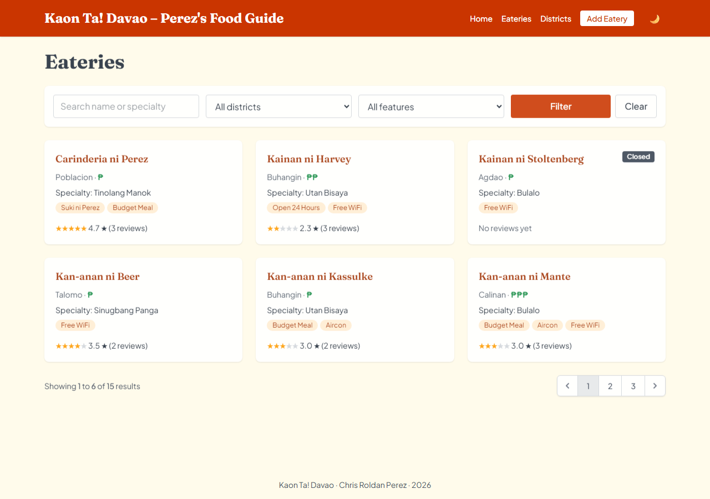
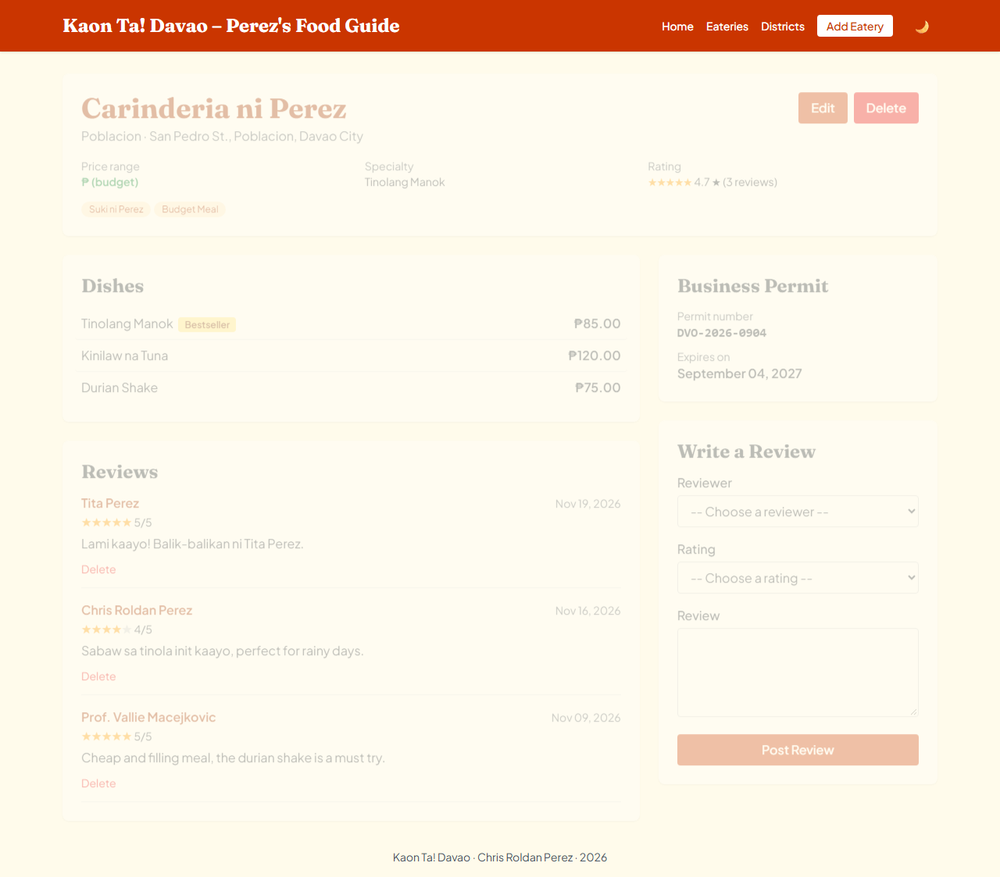
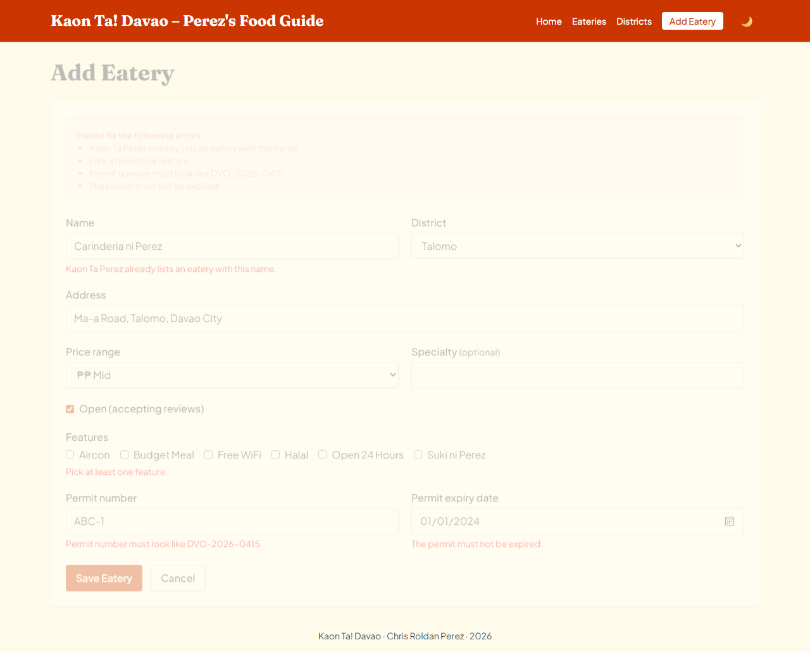

# Kaon Ta! Davao – Perez's Food Guide

**Prefinal Milestone Project – Kaon Ta! Davao: Carinderia & Eatery Guide**
CS Elective 2 Full-Stack Development (Laravel) · Ateneo de Davao University

**Name:** Chris Roldan Perez

A Laravel 12 + SQLite app where the City Tourism Office can list carinderias and eateries by district, show each eatery's business permit, dishes and features, and collect reviews from residents. There is no login. Every page is public, and the review form has a Reviewer select instead.

Extras:
- A **dark/light mode** toggle in the header (the 🌙 / ☀️ button). The choice is saved in the browser's localStorage.
- **Google Fonts**: Fraunces for headings and Plus Jakarta Sans for body text.
- Small **hover effects and fade-in animations**, written as Tailwind classes. They turn off automatically if the computer is set to reduce motion.

## Setup

```bash
composer install
cp .env.example .env
php artisan key:generate
touch database/database.sqlite
php artisan migrate:fresh --seed
npm install
npm run build        # or npm run dev while developing
php artisan serve
```

Then open http://127.0.0.1:8000

## Personalized Data

| Item | Value |
|---|---|
| Site title | Kaon Ta! Davao – Perez's Food Guide |
| Districts (6) | Poblacion, Talomo, Agdao, Buhangin, Toril, Calinan |
| Features (6) | Suki ni Perez, Budget Meal, Halal, Open 24 Hours, Aircon, Free WiFi |
| User 1 | Chris Roldan Perez – perez@kaonta.test (password: `kaonta2026`) |
| User 2 | Tita Perez – tita.perez@kaonta.test (password: `kaonta2026`) |
| Other users | 10 users from the default `UserFactory` (12 users total) |
| My eatery | Carinderia ni Perez (slug `carinderia-ni-perez`), Poblacion, San Pedro St., Poblacion, Davao City, budget, specialty Tinolang Manok, open |
| My eatery's features | Suki ni Perez, Budget Meal (set with `sync()`) |
| My eatery's permit | DVO-2026-0904, expires on September 4, 2027 (my birthday) |
| My eatery's dishes | Tinolang Manok ₱85.00 (Bestseller), Kinilaw na Tuna ₱120.00, Durian Shake ₱75.00 |
| My eatery's reviews | 3 reviews, including Tita Perez, 5 stars: "Lami kaayo! Balik-balikan ni Tita Perez." |
| Other eateries | 14 from `EateryFactory` (3 of them use the `closed()` state), each with 1 permit, 2–5 dishes and 1–3 features |

Totals after seeding: 6 districts, 6 features, 12 users, 15 eateries (3 closed), 15 permits.

## Relationships

| Relationship | Type | Why This Type Fits |
|---|---|---|
| District → Eatery | `hasMany` / `belongsTo` | A district like Poblacion can have a lot of eateries, but one eatery is only located in one district, so the foreign key `district_id` is on the eateries table. |
| Eatery → Dish | `hasMany` / `belongsTo` | Each carinderia serves many dishes, but a dish row like "Tinolang Manok ₱85.00" belongs to just one eatery's menu. |
| Eatery → Review | `hasMany` / `belongsTo` | An eatery can get many reviews from residents, and each review is about only one eatery. |
| User → Review | `hasMany` / `belongsTo` | One reviewer can write many reviews, but every review has exactly one writer, which is why the reviewer page can list all of a user's reviews. |
| Eatery → Permit | `hasOne` / `belongsTo` | An eatery only has one business permit at a time, so `eatery_id` in permits is unique, which makes it one-to-one instead of one-to-many. |
| Eatery ↔ Feature | `belongsToMany` / `belongsToMany` | An eatery can have many features (Halal, Aircon...) and a feature is shared by many eateries, so we need the `eatery_feature` pivot table in between. |
| District → Review (through Eatery) | `hasManyThrough` | Reviews are not directly connected to districts, but we can reach them through the eateries in that district, so we can count "N reviews in Talomo" without looping through every eatery. |

## Route List

Output of `php artisan route:list --except-vendor`:

```
  GET|HEAD        / ............................................................................ home › HomeController
  GET|HEAD        districts ............................................... districts.index › DistrictController@index
  GET|HEAD        districts/{district} ...................................... districts.show › DistrictController@show
  GET|HEAD        eateries ................................................... eateries.index › EateryController@index
  POST            eateries ................................................... eateries.store › EateryController@store
  GET|HEAD        eateries/create .......................................... eateries.create › EateryController@create
  GET|HEAD        eateries/{eatery} ............................................ eateries.show › EateryController@show
  PUT|PATCH       eateries/{eatery} ........................................ eateries.update › EateryController@update
  DELETE          eateries/{eatery} ...................................... eateries.destroy › EateryController@destroy
  GET|HEAD        eateries/{eatery}/edit ....................................... eateries.edit › EateryController@edit
  POST            eateries/{eatery}/reviews .......................... eateries.reviews.store › ReviewController@store
  GET|HEAD        reviewers/{user} .......................................... reviewers.show › ReviewerController@show
  DELETE          reviews/{review} ........................................ reviews.destroy › ReviewController@destroy

                                                                                                   Showing [13] routes
```

## Screenshots

### Eatery List


### Eatery Page with Reviews


### Create Form Showing Validation Errors

